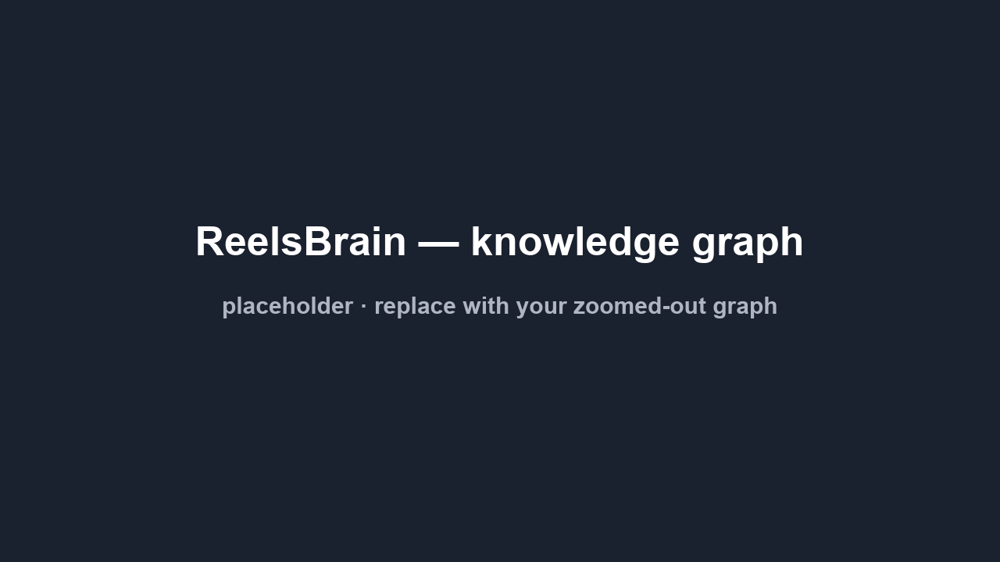
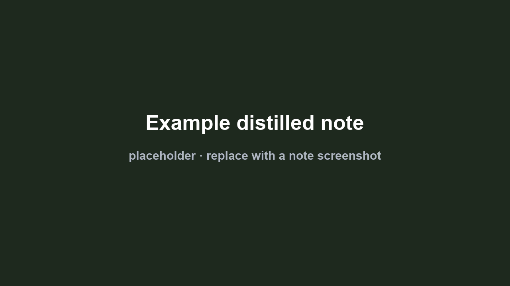
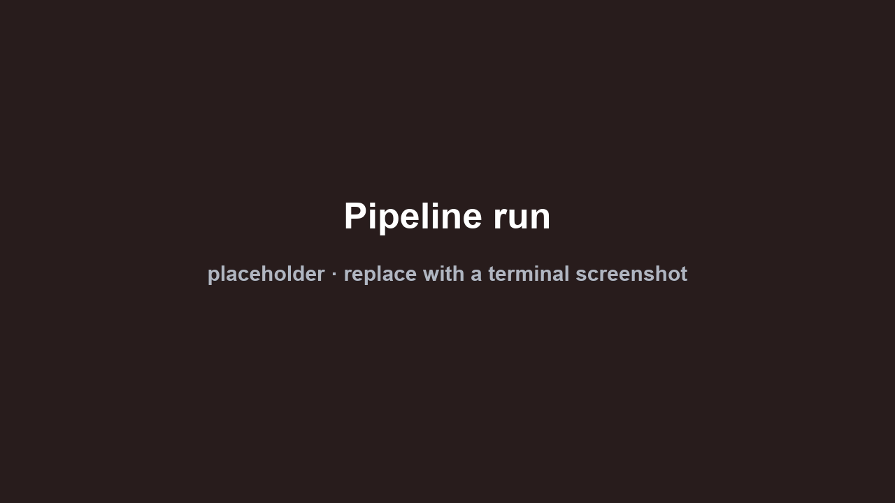
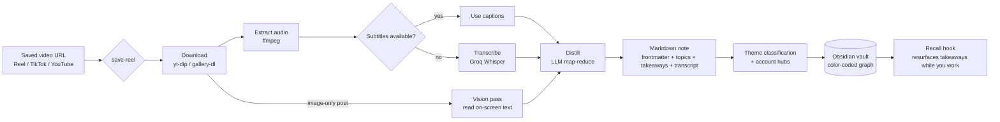

# ReelsBrain

**A personal second brain that automatically transcribes and distills the videos I save.**

Instagram Reels, TikToks and YouTube videos carry a lot of useful ideas, but they are trapped in a format you cannot search, skim or quote. ReelsBrain turns any saved video into a clean, searchable Markdown note in an [Obsidian](https://obsidian.md) vault: it downloads the media, transcribes the audio, distills the content into a title, topics and actionable takeaways, then files the note and wires it into a color-coded knowledge graph by theme.

It runs as a set of [Claude Code](https://claude.com/claude-code) skills, so saving a video is a single command (or a Telegram message), and the knowledge resurfaces on its own while I work.

> This repository is the **system** (the pipeline and the skills). The actual vault and its notes are personal and are not published.

---

## Demo

| Knowledge graph, colored by theme | A generated note | The pipeline running |
|---|---|---|
|  |  |  |

*(The graph is zoomed out so individual note titles do not render — only the themed clusters are visible.)*

---

## How it works



1. **Capture** — send a link (locally via `/save-reel <url>`, or always-on via a Telegram bot that enqueues links to a queue your PC drains).
2. **Fetch** — `yt-dlp` / `gallery-dl` pull the media; `ffmpeg` extracts mono 16 kHz audio.
3. **Transcribe** — use the platform captions when present, otherwise Groq Whisper (`whisper-large-v3-turbo`), chunked for long videos. Image-only posts go through a vision pass that reads the text on the slides.
4. **Distill** — an LLM condenses the transcript into a title, 12–20 topics (including situational synonyms, so recall works even when you phrase things differently) and 3+ actionable takeaways. Long transcripts use a map-reduce pass.
5. **File** — the note is written with YAML frontmatter, deduplicated by content id, classified into one of several themes, linked to a per-account hub, and tagged so the Obsidian graph colors it by theme.
6. **Recall** — a Claude Code hook surfaces the relevant takeaway (matched by synonyms) while you work on a related topic, and cites the note so you can reopen the source.

---

## The skills

| Skill | What it does | Entry point |
|---|---|---|
| **save-reel** | Full pipeline: download → transcribe → distill → file into the vault. Also runs the Telegram capture/drain loop and the vision pass for image posts. | `/save-reel <url>` |
| **transcript** | Lightweight: returns the plain-text transcript of a single video (captions, FR then EN). No distillation, no filing. | `/transcript <url>` |
| **transcript-account** | Transcribes every video of a whole account into one cluster, linked to a central account node in the graph. | `/transcript-account <account-url>` |

---

## Stack & prerequisites

- **Python 3.13** — standard library only, no pip dependencies.
- **Bash** — the orchestration scripts.
- **External CLI tools:** [`yt-dlp`](https://github.com/yt-dlp/yt-dlp), [`ffmpeg`](https://ffmpeg.org/), [`gallery-dl`](https://github.com/mikf/gallery-dl), `curl`.
- **APIs (all optional depending on what you use):** [Groq](https://console.groq.com) (Whisper transcription + LLM distillation + vision), Upstash KV (Telegram queue), Telegram Bot API (always-on capture).

See [`docs/PREREQUISITES.md`](docs/PREREQUISITES.md) for install details.

---

## Setup

1. Install the prerequisites above.
2. Drop the `skills/` folders into your Claude Code skills directory (`~/.claude/skills/`).
3. Copy `skills/save-reel/.env.example` to `skills/save-reel/.env` and fill in your keys. **The `.env` and your cookie files are never committed** (see `.gitignore`).
4. Full architecture and the optional Telegram capture loop are documented in [`skills/save-reel/SETUP.md`](skills/save-reel/SETUP.md).

Quick local test (no Telegram):

```bash
bash ~/.claude/skills/save-reel/scripts/process_reel.sh "<video-url>"
```

---

## License / usage

**No license granted. All rights reserved.**

This repository is public for viewing only. You may read the code, but you may not copy, reuse, redistribute or deploy it, in whole or in part, without written permission. It is not open source.
